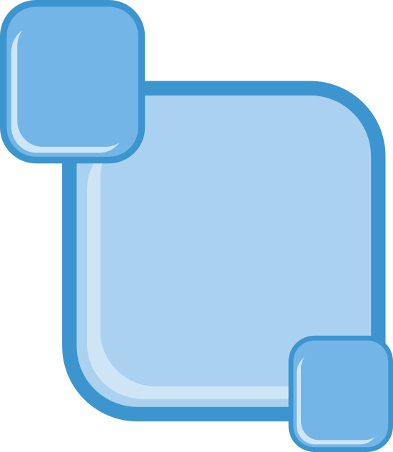

# gelido-w

**gelido-w** é um tema para o VS Code, com variantes escura e clara, de personalidade fria, técnica e aquática. A paleta nasceu de uma ideia de interfaces que parecem gelo fino sobre água profunda, onde a informação flui por baixo de uma camada de vidro.

---

## Temas

| Tema | Descrição |
|---|---|
| **gelido-w-dark** | Escuro. Fundo abissal, ciano elétrico e teal brilhando sobre o fundo profundo. |
| **gelido-w-light** | Claro. Gelo como superfície e abismo como texto, com tons mais escuros da mesma família para manter o contraste. |
| **gelido-w-zero-absoluto** | Escuro. Termômetro dinâmico e gamificado para monitoramento visual de erros e bugs. |

---

### 🌡️ Termômetro de Degelo (Gamificação)
* ❄️ **Zero Absoluto (-40°C)**: Código limpo, zero erros e avisos.
* 🧊 **Congelado / Gelo Fino**: Ambiente estável sob controle.
* 💧 **Derretendo**: Erros e avisos detectados no workspace.
* 🔥 **Degelo Crítico**: Muitos erros no código — hora de debugar!

---

## Paleta

### Núcleo

| Cor | HEX | Papel no tema |
|---|---|---|
| Abismo | `#041f2a` | Fundo do editor (escuro) e texto (claro) |
| Teal | `#00c2a8` | Strings (escuro), status bar e botões (ambos) |
| Ciano elétrico | `#00e5ff` | Keywords, cursor e foco (escuro) |
| Aço azulado | `#3a506b` | Números de linha, bordas, elementos inativos |
| Gelo | `#e6fffb` | Texto principal (escuro) e sidebar (claro) |

---

## Filosofia: programar no gelo

Todo programador conhece o silêncio de uma madrugada com o terminal aberto. O ruído do mundo baixa, o cursor pisca e só restam você e o problema. O gelido-w foi desenhado para esse estado.

Pense em um lago congelado. Na superfície, tudo é nítido, liso e sem excesso. Embaixo, a água segue em movimento. Um bom código funciona assim: a camada visível é limpa, legível e estável, e sob ela correm os dados, as requisições, os estados que mudam a cada instante. O tema tenta traduzir essa imagem.

- **Ciano nos keywords.** São as rachaduras luminosas no gelo, os pontos onde a estrutura da linguagem aparece com clareza: `async`, `return`, `class`. Você sabe onde pisar.
- **Teal nas strings.** O texto literal é a água visível por baixo do vidro, fluida e calma.
- **Aqua claro nas funções.** Cada chamada é uma corrente atravessando a camada de gelo, levando dados de um ponto a outro.
- **Névoa nos comentários.** Eles ficam como vapor sobre a superfície: presentes quando você precisa, discretos quando não precisa.
- **Aço azulado na estrutura.** Números de linha e bordas são a malha de congelamento, a rede silenciosa que sustenta o resto.

O frio aqui não é hostilidade. É precisão. Um compilador não tem pressa nem se emociona, e um bom *debug* acontece com a cabeça fria: você isola, observa, mede, corrige. Escolhemos cores que pedem esse tipo de atenção, sem saturação gritante e sem contraste agressivo, só o brilho certo para o olho achar o que importa.

E existe o aspecto de futuro. O nome **gelido-w** vem da ideia de uma interface que parece de outra época, daquelas telas de realidade aumentada que flutuam diante de você, translúcidas, com dados escorrendo como água por vidro. Escrever código é, no fundo, construir esse tipo de coisa: invisível para quem usa, mas cheia de fluxo por dentro.

Abra um arquivo. Deixe o cursor ciano piscar sobre o fundo profundo. Compile no frio. E, se o dia estiver claro, a versão light espera na superfície.

---

## Preview

---

## Contribuindo

Sugestões de cores, correções de contraste e capturas de tela em diferentes linguagens são bem-vindas. Abra uma issue ou envie um pull request.

## Licença

MIT